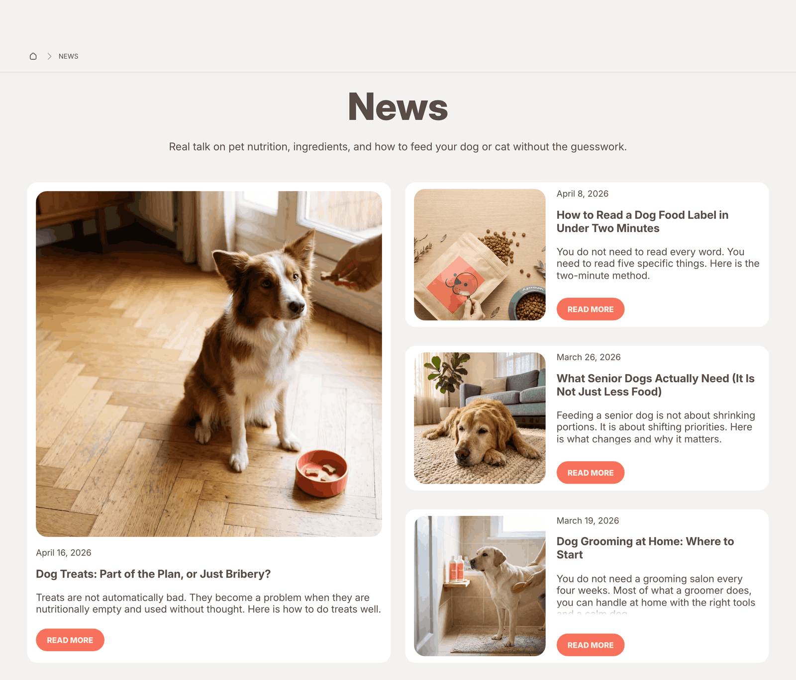

# Blog Listing

The Blog Listing section displays all posts from a blog in a grid or collage layout. Visitors can filter posts by tag and paginate through large numbers of articles.

📌 **When to use it:** This section is part of the blog template and is active on all blog index pages automatically.

**On this page**

- [Section Settings](#section-settings)
  - [Content and Layout](#content-and-layout)
  - [Colors](#colors)
  - [Spacing](#spacing)
- [Blocks](#blocks)
  - [Shape Divider](#shape-divider)
- [Tips](#tips)
- [FAQ](#faq)

---

## ⚙️ Section Settings

### Content and Layout

| Setting | What it does |
|---|---|
| **Show tag filters** | Shows a tag filter bar above the article grid. |
| **Posts per page** | How many articles are shown per page before pagination appears. |
| **Layout** | Controls the overall visual layout of the section. |
| **Image ratio** | The aspect ratio of article images on the blog listing page. |
| **Show article tags** | Shows the article tags below the article title. |
| **Show blog's date** | Shows the publication date on each article card. |
| **Show preview text** | Shows a short excerpt of article text on each blog card. |
| **Heading size** | Controls the visual size of the heading. Options are Small, Medium, Large, and Extralarge. |
| **Paragraph** | The body text for this block. Supports rich text formatting. |
| **Content alignments** | Controls the horizontal alignment of the content block within the section: Left, Center, or Right. |

### Colors

| Setting | What it does |
|---|---|
| **Section's color palette** | Applies a color palette to this section, controlling the background, text, and button colors. Color palettes are defined in Theme Settings. |
| **Use gradient as background** | When enabled, the section uses the gradient defined in the selected color palette instead of a solid background color. |

### Spacing

| Setting | What it does |
|---|---|
| **Padding top** | The amount of empty space above the section content on desktop, in pixels. Increase it to separate this section visually from the one above. |
| **Padding bottom** | The amount of empty space below the section content on desktop, in pixels. |
| **Padding top (mobile)** | The amount of empty space above the section on mobile, in pixels. Can be set independently from desktop. |
| **Padding bottom (mobile)** | The amount of empty space below the section on mobile, in pixels. |

---

## 🧩 Blocks

### Shape Divider

Adds a decorative SVG shape at the top or bottom of the section to create a smooth visual transition into the next section.

| Setting | What it does |
|---|---|
| **Choose position** | Whether the Shape Divider appears at the top or bottom of the section. |
| **Section's color palette** | The color palette of the divider shape. Typically matches the section it belongs to. |
| **Next section's background color** | The exact background color of the section immediately below this one. Setting this correctly makes the divider edge blend seamlessly. |
| **Style** | The visual shape of the divider: Waves, Deep waves, Arc, Big curve, Oblique line, Triangle, or one of the shaded pattern options. |

---

## 💡 Tips

- Enable tag filtering if your blog has clearly defined categories.

- Make sure all articles have a featured image. The layout looks significantly better with images.

---

## ❓ FAQ

**Can I show articles from multiple blogs on the same page?**\
No. Each blog page shows articles from one blog only.

