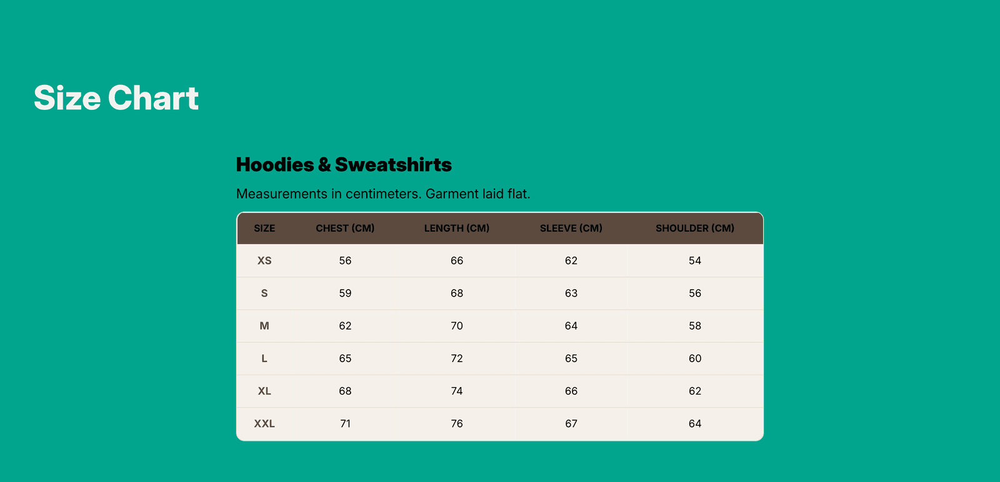

# Page Content

The Page Content section renders the content of a standard Shopify page exactly as written in the page editor. Layout, heading size, color scheme, and spacing are controlled from the section settings.

📌 **When to use it:** This section is part of the page template and active on all standard pages by default.

**On this page**

- [Section Settings](#section-settings)
  - [Content and Layout](#content-and-layout)
  - [Colors](#colors)
  - [Spacing](#spacing)
- [Tips](#tips)
- [FAQ](#faq)

---

## ⚙️ Section Settings

### Content and Layout

| Setting | What it does |
|---|---|
| **Heading size** | Controls the visual size of the heading. Options are Small, Medium, Large, and Extralarge. |
| **Heading alignments** | Controls the horizontal alignment of the content block within the section: Left, Center, or Right. |

### Colors

| Setting | What it does |
|---|---|
| **Section's color palette** | Applies a color palette to this section, controlling the background, text, and button colors. Color palettes are defined in Theme Settings. |
| **Use gradient as background** | When enabled, the section uses the gradient defined in the selected color palette instead of a solid background color. |

### Spacing

| Setting | What it does |
|---|---|
| **Padding top** | The amount of empty space above the section content on desktop, in pixels. Increase it to separate this section visually from the one above. |
| **Padding top (mobile)** | The amount of empty space above the section on mobile, in pixels. Can be set independently from desktop. |
| **Padding bottom** | The amount of empty space below the section content on desktop, in pixels. |
| **Padding bottom (mobile)** | The amount of empty space below the section on mobile, in pixels. |

---

## 💡 Tips

- For rich content with images and formatted text, write it in the Shopify page editor.

---

## ❓ FAQ

**Can I add sections to a standard page?**\
Yes. From the Theme Editor, add sections above or below this section on the page template.

